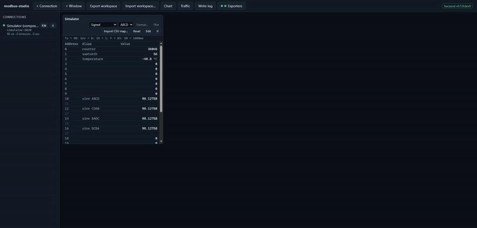
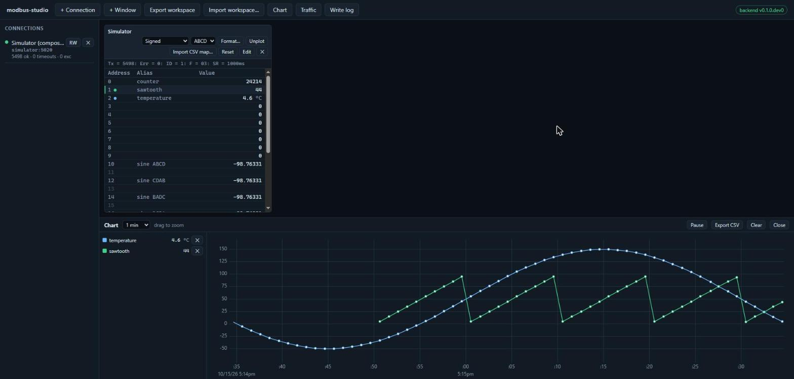
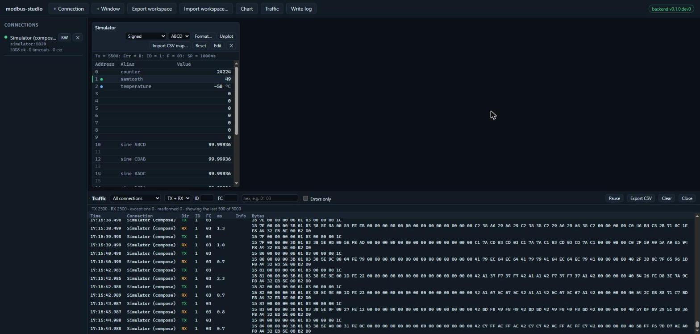
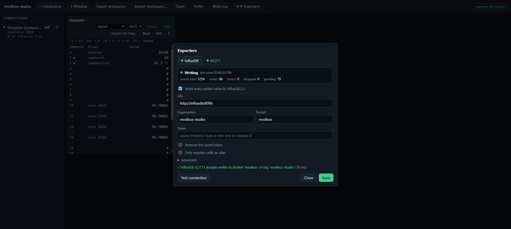
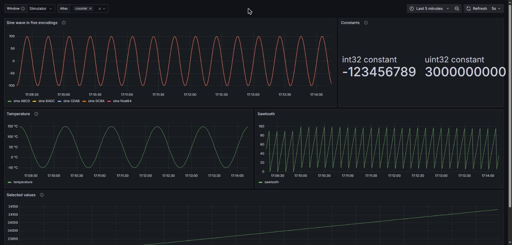

# modbus-studio

[](https://github.com/electrolabopen/modbus-studio/actions/workflows/ci.yml)
[](LICENSE)
[](https://github.com/electrolabopen/modbus-studio/pkgs/container/modbus-studio)

**English** · [Español](README.es.md)

An open-source Modbus master that runs in your browser. It polls Modbus TCP, RTU and
RTU-over-TCP devices, decodes their registers into engineering values, writes coils and
registers, and shows every frame on the wire. It is written from scratch from the public
Modbus specification. Run it on your laptop, or on a gateway or Raspberry Pi on the plant
network and open it from any browser.



> **Status: pre-alpha, version 0.1.0.** Everything under [Working now](#working-now) is
> done and tested; what is left is [in development](#in-development). See the
> [roadmap](docs/ROADMAP.md) and the [changelog](CHANGELOG.md).

## Features

### Working now

| Area | What works |
|---|---|
| Protocols | Modbus TCP, RTU over TCP and RTU on a serial port: port discovery and line settings in the UI ([Linux guide](docs/rtu-linux.md)) |
| Functions | Read FC01–FC04, write FC05/06/15/16 |
| Decoding | signed, unsigned, hex, binary, 32-bit long/float, 64-bit long/double; byte orders ABCD, CDAB, BADC, DCBA; scale and unit per register (engineering values) |
| Polling windows | Several windows, each with its own connection, slave ID, function and scan rate; Tx/Err counters |
| Formats and aliases | Per-cell and per-range formats, aliases edited in the table, CSV register maps |
| Writes | Double-click a cell, confirmation dialog, values in engineering units, write log; read-only connections |
| Workspaces | JSON workspaces with autosave, import and export |
| Traffic monitor | Raw TX/RX frames with filters, pause, counters and CSV export |
| Chart | Real-time chart of selected registers (uPlot), pause, zoom, CSV export |
| InfluxDB | Export to InfluxDB 2.x, compose profile with Grafana and a dashboard for the simulator ([guide](docs/influxdb.md)) |
| MQTT | Publish every value as JSON (value, unit, timestamp) on a configurable topic, QoS 0/1/2, retain, TLS; compose profile with Mosquitto ([guide](docs/mqtt.md)) |
| Exporter settings | InfluxDB and MQTT configured from the UI, with live status, counters and a connection test; tokens and passwords are typed, never shown |
| API | REST API + WebSocket, the same API the UI uses; OpenAPI at `/docs` |
| Security | Binds to 127.0.0.1 by default, optional API token |
| Docker | `docker compose up` with the bundled simulator |
| Phones and tablets | The toolbar folds into a menu on narrow screens, so the UI works from a phone on the plant floor |

### In development

| Feature | Where |
|---|---|
| RTU with a physical USB-RS485 adapter: tested only over virtual ports so far | 0.2.0 (phase 6, part 3) |
| A physical Raspberry Pi 4/5: the arm64 image is tested on GitHub's arm64 runners and under QEMU so far | 0.2.0 |

See the [roadmap](docs/ROADMAP.md) for the phases and what each one has to pass.

## Screenshots

A polling window with the simulator's register map applied, and the real-time chart of
two of its registers:



The traffic monitor, with every request and response in hex:



The exporters dialog: InfluxDB and MQTT settings, live status and a connection test:



The same values in Grafana, exported to InfluxDB (`docker compose --profile influxdb up`):



## Quick start

### Docker (app + simulator)

```bash
git clone https://github.com/electrolabopen/modbus-studio.git
cd modbus-studio
docker compose up --build
```

Then open <http://127.0.0.1:8000>. A connection to the bundled simulator and a demo
window are preloaded from [`docker/demo-workspace.json`](docker/demo-workspace.json), so
values update right away.

Which host to use depends on where the Modbus master runs:

| Master | Host | Port |
|---|---|---|
| modbus-studio inside compose | `simulator` (service name) | 5020 TCP, 5021 RTU over TCP |
| Any tool on the host PC | `127.0.0.1` | 5020 TCP, 5021 RTU over TCP |

Connections and windows are saved in the `modbus-studio-data` volume after every change
and restored when the container restarts or is recreated. The demo workspace only seeds
the first start, so a demo connection you delete stays deleted. To start over from the
demo, remove the volume with `docker compose down -v`.

Inside the app container `127.0.0.1` is the container itself, so a connection to
`127.0.0.1:5020` created from the UI fails; the sidebar says why. To check the stack:

```bash
docker compose up -d --build --wait
python docker/smoke_test.py      # app -> simulator through the compose network
# the workspace survives the app container being killed:
python docker/smoke_test.py persist-write
docker compose kill modbus-studio && docker compose up -d --wait
python docker/smoke_test.py persist-check
```

### With InfluxDB and Grafana

```bash
docker compose --profile influxdb up --build
```

adds InfluxDB 2 and Grafana: polled values are exported to InfluxDB and Grafana
(<http://127.0.0.1:3000>) opens on a dashboard for the simulator. See
[`docs/influxdb.md`](docs/influxdb.md).

### With Mosquitto (MQTT)

```bash
docker compose --profile mqtt up --build
docker compose exec mosquitto mosquitto_sub -u modbus-studio -P modbus-studio -t 'modbus-studio/#' -v
```

adds Mosquitto, and every polled value is published to it as JSON. Both profiles can
run together (`--profile influxdb --profile mqtt`). See [`docs/mqtt.md`](docs/mqtt.md).

The passwords and the token of these profiles are **development defaults**: change them
before exposing anything (see the guides).

### With pip

From 0.1.0 on, modbus-studio is on PyPI, with the UI included (no Node.js needed):

```bash
pipx install modbus-studio      # or: pip install modbus-studio
modbus-studio                   # http://127.0.0.1:8000
modbus-studio-sim               # optional: the slave simulator on :5020 / :5021
```

### Docker image

Multi-arch images (`linux/amd64`, `linux/arm64`, so also a Raspberry Pi 4/5 with a
64-bit OS) are published to
[`ghcr.io/electrolabopen/modbus-studio`](https://github.com/electrolabopen/modbus-studio/pkgs/container/modbus-studio):

```bash
docker run -d --name modbus-studio -p 127.0.0.1:8000:8000 \
  -v modbus-studio-data:/data ghcr.io/electrolabopen/modbus-studio:edge
```

| Tag | |
|---|---|
| `edge` | the latest commit on `main` that passed CI |
| `sha-<commit>` | a given commit on `main` |
| `0.1.0`, `0.1`, `latest` | releases, from 0.1 on |

The image listens on port 8000 inside the container; publish it on `127.0.0.1` as above,
or see [Running on a gateway or plant network](#running-on-a-gateway-or-plant-network)
before opening it to the network. The workspace and the write log live in `/data`. For a
USB-RS485 adapter add `--device /dev/ttyUSB0` ([`docs/rtu-linux.md`](docs/rtu-linux.md)).

### From source

Requires Python ≥ 3.10 and Node ≥ 20.

```bash
git clone https://github.com/electrolabopen/modbus-studio.git
cd modbus-studio

# backend
cd backend
python -m venv .venv
. .venv/bin/activate            # Windows: .venv\Scripts\activate
pip install -e ".[dev]"
modbus-studio-sim &             # slave simulator on :5020 / :5021
modbus-studio                   # API on http://127.0.0.1:8000

# frontend (dev server with hot reload, proxies /api to the backend)
cd ../frontend
npm install
npm run dev                     # http://127.0.0.1:5173
```

`npm run build` compiles the UI into `backend/src/modbus_studio/static`, and the Python
server then serves it on its own port.

## Running on a gateway or plant network

By default the server only listens on `127.0.0.1`. To reach it from other machines:

```bash
export MODBUS_STUDIO_HOST=0.0.0.0
export MODBUS_STUDIO_TOKEN="$(openssl rand -hex 24)"
modbus-studio
```

With a token set, every API call must send `Authorization: Bearer <token>`. **Anyone who
can reach the API can write to your devices.** Do not expose it without a token, and
preferably keep it behind a VPN or a reverse proxy with TLS.

| Variable | Default | Purpose |
|---|---|---|
| `MODBUS_STUDIO_HOST` | `127.0.0.1` | Bind address |
| `MODBUS_STUDIO_PORT` | `8000` | HTTP port |
| `MODBUS_STUDIO_TOKEN` | *(unset)* | Require this bearer token on the API |
| `MODBUS_STUDIO_TRAFFIC_BUFFER` | `5000` | Frames kept for the traffic monitor |
| `MODBUS_STUDIO_WORKSPACE` | *(unset)* | Workspace JSON with connections and windows to load at startup |
| `MODBUS_STUDIO_WRITE_LOG_FILE` | *(unset; `/data/writes.jsonl` in Docker)* | Append every write to this JSON Lines file |
| `MODBUS_STUDIO_STATE_FILE` | *(unset; `/data/workspace.json` in Docker)* | Save the workspace here after every change and restore it at startup; once it exists it takes precedence over `MODBUS_STUDIO_WORKSPACE` |

## Workspaces, register maps and the write log

- **Workspaces.** Connections, windows, formats and aliases are saved after every change
  (in Docker: `/data/workspace.json`) and restored at startup. **Export workspace** downloads the
  session as JSON; **Import workspace…** loads one, replacing the session or adding to it.
- **CSV register maps.** **Import CSV map…** on a window applies a file with the columns
  `address,alias,type,byte_order,scale,unit` (only `address` is required, `,` or `;`
  separated). Every row is checked first and problems are listed by line; nothing is
  applied until the whole file is valid. Addresses are 0-based protocol addresses.
  [`docs/examples/simulator-map.csv`](docs/examples/simulator-map.csv) describes the
  bundled simulator: import it into an FC03 window at address 0, quantity 28.
- **Write log.** Every write sent from the UI or the API is recorded with the time,
  connection, device, function, address, the value shown before and the new value,
  including writes the device rejected. **Write log** in the toolbar shows it; it is kept
  in `/data/writes.jsonl` (`MODBUS_STUDIO_WRITE_LOG_FILE` outside Docker).

## Modbus RTU on a serial port

Pick **Modbus RTU (serial port)** in **+ Connection**: the dialog lists the serial ports
of the machine running the server. [`docs/rtu-linux.md`](docs/rtu-linux.md) covers USB-RS485
adapters on Linux (`dialout`, udev rules, `/dev/serial/by-id`, Docker `--device`, wiring)
and how to try RTU without hardware: with socat on Linux, or com0com on Windows.

The simulator can also be an RTU slave on a serial port:

```bash
modbus-studio-sim --serial /dev/ttyUSB0                 # 19200 8E1, plus the TCP ports
modbus-studio-sim --tcp-port 0 --rtu-tcp-port 0 --serial COM10 --baudrate 9600 --parity N
```

## Simulator register map

`modbus-studio-sim` serves device IDs 1 and 2. Holding and input registers share this
layout (0-based protocol addresses):

| Address | Type | Content |
|---|---|---|
| 0 | uint16 | counter, +1 per second |
| 1 | uint16 | sawtooth 0–100, 10 s period |
| 2 | int16 | temperature ×10, −50.0 … 150.0 °C (use scale 0.1) |
| 10–11 / 12–13 / 14–15 / 16–17 | float32 | same sine wave as ABCD / CDAB / BADC / DCBA |
| 20–23 | float64 | the same sine wave, ABCD |
| 24–25 | int32 | −123456789, ABCD |
| 26–27 | uint32 | 3000000000, CDAB |
| 100–199 | — | free, writable |

There are 100 writable coils (0–99). Discrete inputs 0–15 show a bit that moves one
position per second.

## Byte order naming

`A` is the most significant byte of a 32-bit value:

| Name | Registers | Also known as |
|---|---|---|
| ABCD | `[AB, CD]` | big-endian |
| CDAB | `[CD, AB]` | word swap / little-endian word order |
| BADC | `[BA, DC]` | byte swap |
| DCBA | `[DC, BA]` | little-endian |

For 64-bit values the same two operations apply to all four words.

## Documentation

| Guide | |
|---|---|
| [`docs/rtu-linux.md`](docs/rtu-linux.md) | USB-RS485 adapters on Linux, udev, Docker `--device`, wiring; RTU without hardware (socat, com0com) |
| [`docs/influxdb.md`](docs/influxdb.md) | InfluxDB exporter: what is written, settings, buffering, Grafana, credentials |
| [`docs/mqtt.md`](docs/mqtt.md) | MQTT exporter: topics, JSON payload, QoS, TLS, Mosquitto |
| [`docs/examples/simulator-map.csv`](docs/examples/simulator-map.csv) | CSV register map of the bundled simulator |
| [`docs/ROADMAP.md`](docs/ROADMAP.md) | Phases, what each one has to pass, design notes |
| [`docs/releasing.md`](docs/releasing.md) | Publishing the image and releases (maintainers) |
| [`CHANGELOG.md`](CHANGELOG.md) | Changes per release |
| `http://127.0.0.1:8000/docs` | The REST API (OpenAPI), served by the app itself |

## Contributing

See [CONTRIBUTING.md](CONTRIBUTING.md). Bugs and feature requests go to the
[issue tracker](https://github.com/electrolabopen/modbus-studio/issues). This is a clean-room project: please do not
contribute code, screenshots, icons or text taken from proprietary Modbus tools.

## License and disclaimer

MIT, see [LICENSE](LICENSE).

modbus-studio is an independent project. It is **not affiliated with, endorsed by or
sponsored by Witte Software**. "Modbus" is a trademark of Schneider Electric USA, Inc.;
the protocol specifications are published by the Modbus Organization at
<https://modbus.org>.
